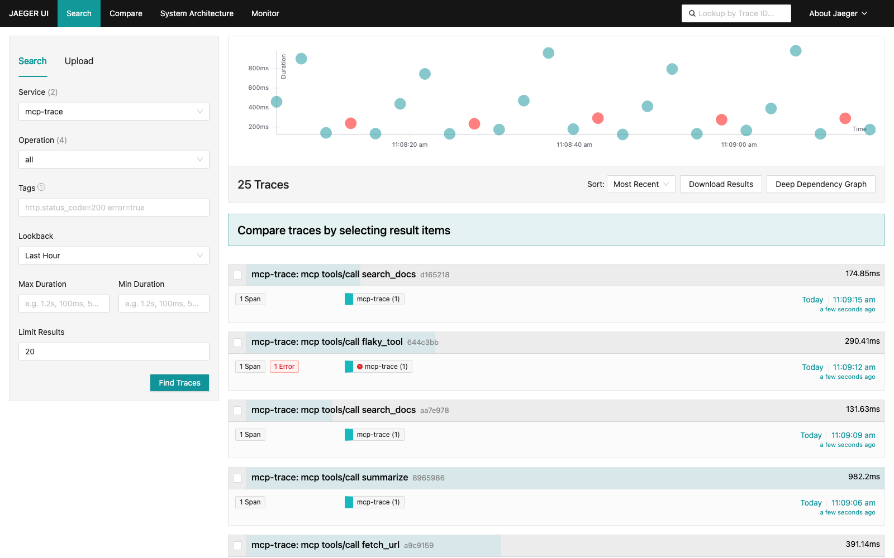
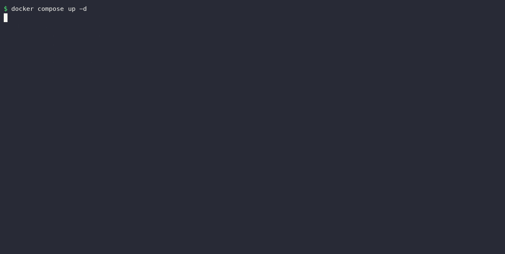

# mcp-trace

[](https://github.com/anhermon/mcp-trace/actions/workflows/ci.yml)
[](https://go.dev/)
[](https://github.com/anhermon/mcp-trace/releases)
[](LICENSE)

**See what your MCP server is actually doing.** An agent calls a tool, it takes
four seconds or fails, and all you have is a client that says "using tool". No
timings, no error text, no history — nothing you can debug or put on a dashboard.

mcp-trace is a transparent proxy you put in front of any MCP server speaking the
HTTP+SSE transport. Every `tools/call` comes out the other side as an
[OpenTelemetry](https://opentelemetry.io/) span — tool name, wall-clock
duration, ok/error, and trace context propagated both ways — in Jaeger, Tempo,
Honeycomb, or anything else that speaks OTLP. The client does not change; you
point it at the proxy's port instead of the server's.



Every row is one MCP tool call: name, duration, and a red badge on the failed
one.

```
MCP Client  →  mcp-trace :8001  →  MCP Server :8000
                     ↓
              OTLP :4317  →  Collector  →  Jaeger / Tempo / Honeycomb
```

## Does this fit your setup? Read this first

mcp-trace supports three MCP transports. Pick the one that matches how your MCP server communicates:

| Your MCP server speaks | mcp-trace | Command example |
|------------------------|-----------|-----------------|
| **HTTP+SSE** (`event: endpoint` handshake, separate GET stream and POST endpoint) | ✅ fully supported | `mcp-trace --transport sse --target http://localhost:8000/sse` |
| **Streamable HTTP** (one POST endpoint; JSON or `text/event-stream` on that response) | ✅ fully supported | `mcp-trace --transport streamable --target http://localhost:8000/mcp` |
| **stdio subprocess, HTTP client** (mcp-trace listens on HTTP and talks stdio to a local server; the client does not get a raw stdio pipe) | ✅ fully supported | `mcp-trace --stdio -- npx -y @modelcontextprotocol/server-filesystem ~/Documents` |

Be aware that the official MCP SDKs now mark HTTP+SSE as a legacy transport and
point new work at Streamable HTTP. mcp-trace supports both, along with stdio for
local MCP servers.

## Try it: the demo bundle

Everything below runs with only Docker installed — proxy, OTel Collector,
Jaeger, and a small fake MCP server generating tool calls. The bundle binds
host ports `8001` (mcp-trace) and `16686` (Jaeger UI); if either is already in
use, edit the `ports:` entries in `docker-compose.yml` before starting it.

```bash
git clone https://github.com/anhermon/mcp-trace
cd mcp-trace
docker compose up -d
open http://localhost:16686   # Jaeger UI → select service "mcp-trace"
```

Spans appear within a few seconds. `docker compose down` when you are done.



*The same bundle, start to first trace.*

The demo traffic comes from `examples/demo` — delete the `demo-server` and
`demo-client` services from `docker-compose.yml` and point `--target` at your
own server to trace the real thing.

## Install

Install the latest version:

```bash
go install github.com/anhermon/mcp-trace/v2/cmd/mcp-trace@latest
```

Or pin to a specific release (recommended for production):

```bash
go install github.com/anhermon/mcp-trace/v2/cmd/mcp-trace@v2.0.4
```

Or download a binary for your platform from
[Releases](https://github.com/anhermon/mcp-trace/releases).

**PATH note:** If you have an older version installed elsewhere (e.g.
`~/.local/bin`), it may shadow the one in `~/go/bin`. Run `which mcp-trace` and
`mcp-trace version` to verify you're running the expected binary.

## Usage

### HTTP+SSE transport (legacy)

Put mcp-trace in front of your HTTP+SSE MCP server:

```bash
mcp-trace --transport sse --target http://localhost:8000/sse --port 8001 --otel-endpoint localhost:4317
```

Point your MCP client at `:8001` instead of `:8000`. Zero client changes required.

### Streamable HTTP transport

For modern MCP servers using Streamable HTTP:

```bash
mcp-trace --transport streamable --target http://localhost:8000/mcp --port 8001 --otel-endpoint localhost:4317
```

Point your client at `:8001`. `--target` is the exact URL mcp-trace POSTs to;
the client's path is not appended. The Python MCP SDK and FastMCP mount
Streamable HTTP at `/mcp` by default, so `--target http://localhost:8000`
(the origin, no path) is a POST to `/` and the server answers **404**. Use
the path your server actually serves. The demo server in this repo is
HTTP+SSE on `/sse`, not Streamable HTTP — do not point this mode at it.

### stdio transport (HTTP in front of a local subprocess)

`--stdio` does **not** make mcp-trace a stdio MCP server. It still listens on
HTTP. The process after `--` is the only stdio peer: mcp-trace starts it and
writes JSON-RPC to its stdin and reads stdout. Do not put `mcp-trace` in a
client's stdio `command` field — there is no raw stdio pipe on the client side.

```bash
mcp-trace --stdio -- npx -y @modelcontextprotocol/server-filesystem ~/Documents
```

Point an HTTP / Streamable HTTP client at `http://localhost:8001` (or `--port`).
Each request is forwarded to the subprocess, and the response is an OTel span
plus a normal HTTP body.

The HTTP side is a full Streamable HTTP endpoint:

- A client that accepts `text/event-stream` gets each response as an event
  stream. The stream also carries what the subprocess sends while that
  request is open: log and progress notifications, plus requests to the
  client (`sampling/createMessage`, `elicitation/create`, `roots/list`). The
  client POSTs its answer, and mcp-trace writes it to the subprocess's stdin.
  A JSON-only client still gets plain `application/json`.
- `GET` with `Accept: text/event-stream` opens the standalone stream for
  messages that arrive when no request stream is open.
- `initialize` gets an `Mcp-Session-Id`, but it does not isolate clients:
  every client shares the one subprocess, which sees a single session, and
  requests without the header are still served.
- Request ids and progress tokens are rewritten on the way to the subprocess
  and restored on the way back, and cancellations are matched within the
  client's session, so concurrent clients that reuse ids (every SDK starts at
  0 or 1) never get each other's responses or progress.

A stdio subprocess doesn't say which request a notification or server
request belongs to, so mcp-trace routes it as follows:

- Progress goes to the request that set the matching `progressToken`.
- Anything else goes to the most recently opened request stream, or else
  the newest `GET` stream.
- If no stream is open, the subprocess gets a JSON-RPC error instead of
  waiting forever. The same happens when the stream a server request went
  out on closes before the client answers it.
- Progress for a request that has ended, or whose client takes only JSON, is
  dropped rather than delivered to another client.

With more than one client connected, the newest-stream rule can hand one client's
messages to another: log notifications and server requests, including a
sampling prompt or an elicitation question, go to whichever request stream
opened last, even when it belongs to a different client, and that client's
answer goes back to the subprocess. Run one `--stdio` proxy per client when
that matters.

Two more limits of sharing one subprocess:

- `mcp.client.name` and `mcp.client.version` on spans come from the most
  recent `initialize`, so with several clients a span can carry another
  client's name.
- One reader serves every client. A client that stops reading its event
  stream can fill its 64-message buffer, and from then on every client's
  traffic from the subprocess waits until that client reads again or
  disconnects.

On shutdown mcp-trace closes the subprocess's stdin and, if it is still
running after 5 seconds, kills that process only. A server that ignores the
end of stdin, or a child of a wrapper such as `npx` or `sh -c`, can be left
running; nothing is cleaned up if mcp-trace itself is killed with SIGKILL.

Relayed server requests get their own span (`mcp.direction=server_to_client`,
a child of the request in flight). The 30-second response timeout is paused
while the subprocess waits on the client, for example while a person answers
an elicitation.

**Another example** with a Python MCP server:

```bash
mcp-trace --stdio -- python3 -m my_mcp_server --some-flag
```

The `--` separator is required: everything after it becomes the subprocess command.

### Docker

Build the image locally:

```bash
docker build -t mcp-trace:dev .
docker run --rm -p 8001:8001 mcp-trace:dev \
  --target http://host.docker.internal:8000/sse \
  --otel-endpoint host.docker.internal:4317
```

`-p 8001:8001` is what makes the proxy reachable from the host — without it the
container listens on `:8001` inside its own network namespace and your MCP
client cannot connect.

No `ghcr.io` image is published. Build locally as above.

## Configuration

All flags can be set via a `.mcp-trace.yaml` file (see `.mcp-trace.yaml.example`).

| Flag | Default | Description |
|------|---------|-------------|
| `--transport` | `sse` | Transport mode: `sse`, `streamable`, or `stdio` |
| `--target` | *(required for sse/streamable)* | Upstream MCP server URL |
| `--stdio` | `false` | Use stdio transport (shorthand for `--transport stdio`); remaining args after `--` become the command |
| `--port` | `8001` | Local port to listen on |
| `--otel-endpoint` | `localhost:4317` | OTLP gRPC endpoint |
| `--otel-http` | `false` | Use HTTP OTLP exporter instead of gRPC |
| `--otel-http-endpoint` | `http://localhost:4318` | OTLP HTTP endpoint |
| `--otel-insecure` | `true` | Disable TLS for OTLP |
| `--otel-stdout` | `false` | Print spans to stdout (for testing without a collector) |
| `--service-name` | `mcp-trace` | OTel `service.name` resource attribute |
| `--trace-all` | `false` | Trace all JSON-RPC methods (not just `tools/call`) |
| `--include-lifecycle` | `false` | Include `initialize`/`ping`/`notifications/*` |
| `--capture-tool-args` | `false` | Record full tool arguments on spans (may contain secrets) |
| `--allowed-hosts` | *(localhost only)* | Extra hostnames accepted in the `Host`/`Origin` headers, comma-separated; `*` disables the check. See [DNS-rebinding protection](#dns-rebinding-protection) |
| `--log-level` | `info` | `debug` \| `info` \| `warn` \| `error` |
| `--config` | | Path to config file |

### DNS-rebinding protection

**Breaking change (upgrading from earlier versions):** mcp-trace now answers HTTP 403 to any request whose `Host` header, or `Origin` header when present, is not `localhost`, a `*.localhost` name or a loopback address. This applies to every transport (`sse`, `streamable`, `stdio`). If clients reach the proxy under another name or IP (a Docker Compose service name, a LAN hostname, a reverse proxy), add it with `--allowed-hosts` / `MCP_TRACE_ALLOWED_HOSTS` / `allowed_hosts`.

mcp-trace only serves requests whose `Host` header, and `Origin` header when
there is one, is `localhost`, a `*.localhost` name, or a loopback address
(`127.0.0.0/8`, `::1`). Anything else gets HTTP 403 with a JSON-RPC error and
never reaches the upstream server. This stops a web page from using DNS
rebinding to drive your local MCP server through the proxy, as the
[MCP transport spec](https://modelcontextprotocol.io/specification/2025-11-25/basic/transports#security-warning)
asks of local HTTP servers. mcp-trace has to do this itself: it rewrites `Host`
to `--target` when forwarding, so the upstream's own check never sees the
original value.

If clients reach the proxy under another name (a Docker Compose service name,
a LAN hostname or IP), allow it explicitly:

```bash
mcp-trace --transport streamable --target http://localhost:8000/mcp --allowed-hosts mcp-trace,10.0.0.5
```

Ports are ignored. `--allowed-hosts '*'` turns the check off and logs a warning.

### Server-to-client requests (sampling, elicitation)

In Streamable HTTP mode, requests the server sends to the client
(`sampling/createMessage`, `elicitation/create`, `roots/list`) are relayed as
soon as they arrive, on the POST response stream or the `GET` stream, and the
client's answer is relayed back upstream. Each round-trip becomes its own span
(`mcp sampling/createMessage`, attribute `mcp.direction=server_to_client`),
a child of the `tools/call` span it happened in, so a slow model or a human
answering an elicitation shows up as such. Server-initiated `ping` follows
`--include-lifecycle`.

## Testing without a collector

If you want to see spans without running a full OTLP collector stack:

```bash
mcp-trace --stdio --otel-stdout -- npx -y @modelcontextprotocol/server-filesystem ~/Documents
```

Spans are printed to stdout in a human-readable format. Useful for quick testing,
CI pipelines, or debugging trace instrumentation.

**Collector warning:** Without `--otel-stdout`, mcp-trace tries to send spans to an
OTLP collector at `localhost:4317` (gRPC) or the `--otel-endpoint` you specify. If
no collector is running, **spans are lost silently** after a ~15 second connection
timeout. mcp-trace logs a warning at startup, but tool calls still succeed — making
it easy to believe tracing works when it doesn't. Always verify your collector is
reachable, or use `--otel-stdout` for local testing.

### Running a minimal OTLP collector

If you don't want the full Docker Compose stack, you can run just the OTel Collector:

```bash
# Using Docker
docker run -p 4317:4317 -p 4318:4318 \
  otel/opentelemetry-collector:latest \
  --config <(echo '
receivers:
  otlp:
    protocols:
      grpc:
      http:
exporters:
  debug:
    verbosity: detailed
service:
  pipelines:
    traces:
      receivers: [otlp]
      exporters: [debug]
')
```

This prints spans to the collector's stdout. Replace the `debug` exporter with
`otlp/jaeger`, `otlp/tempo`, or another backend for production use.

## Environment variables

Every CLI flag can also be set via an environment variable using the `MCP_TRACE_` prefix. Nested OTel keys use `_` as a separator (`.` → `_`).

| Environment variable | Equivalent flag | Example |
|----------------------|-----------------|---------|
| `MCP_TRACE_TRANSPORT` | `--transport` | `streamable` |
| `MCP_TRACE_TARGET` | `--target` | `http://localhost:8000/sse` |
| `MCP_TRACE_PORT` | `--port` | `8001` |
| `MCP_TRACE_OTEL_ENDPOINT` | `--otel-endpoint` | `localhost:4317` |
| `MCP_TRACE_OTEL_HTTP` | `--otel-http` | `true` |
| `MCP_TRACE_OTEL_HTTP_ENDPOINT` | `--otel-http-endpoint` | `http://localhost:4318` |
| `MCP_TRACE_OTEL_INSECURE` | `--otel-insecure` | `true` |
| `MCP_TRACE_OTEL_STDOUT` | `--otel-stdout` | `true` |
| `MCP_TRACE_OTEL_SERVICE_NAME` | `--service-name` | `my-mcp-server` |
| `MCP_TRACE_TRACE_ALL` | `--trace-all` | `true` |
| `MCP_TRACE_INCLUDE_LIFECYCLE` | `--include-lifecycle` | `true` |
| `MCP_TRACE_ALLOWED_HOSTS` | `--allowed-hosts` | `mcp-trace,10.0.0.5` |
| `MCP_TRACE_CAPTURE_TOOL_ARGS` | `--capture-tool-args` | `true` |
| `MCP_TRACE_LOG_LEVEL` | `--log-level` | `debug` |

> The service-name variable is `MCP_TRACE_OTEL_SERVICE_NAME`, not
> `MCP_TRACE_SERVICE_NAME` — the underlying config key is `otel.service_name`.

Environment variables override config-file values. CLI flags take the highest precedence.

**Docker example** — run mcp-trace entirely via environment, no flags needed:

```bash
docker run --rm -p 8001:8001 \
  -e MCP_TRACE_TARGET=http://host.docker.internal:8000/sse \
  -e MCP_TRACE_OTEL_ENDPOINT=host.docker.internal:4317 \
  -e MCP_TRACE_OTEL_SERVICE_NAME=my-service \
  mcp-trace:dev
```

## Span schema

Every traced call produces a span with these attributes:

| Attribute | Present on | Description |
|-----------|------------|-------------|
| `mcp.method` | all spans | JSON-RPC method |
| `mcp.request.id` | all spans | JSON-RPC request id |
| `mcp.server.target` | all spans | Upstream URL |
| `mcp.duration_ms` | all spans | Wall-clock duration in ms |
| `mcp.status` | all spans | `ok`, `error`, `timeout`, or `abandoned` |
| `mcp.session.id` | when the server advertises one | MCP session — groups one client's calls |
| `mcp.client.name` | when the client sent `initialize` | Client name from `clientInfo` |
| `mcp.client.version` | when the client sent `initialize` | Client version from `clientInfo` |
| `mcp.direction` | server-to-client requests only | `server_to_client` (sampling, elicitation, roots/list relayed to the client) |
| `mcp.tool.name` | tools/call only | Tool name |
| `mcp.tool.argument_keys` | tools/call with arguments | Argument names, comma-separated |
| `mcp.tool.arguments` | tools/call, with `--capture-tool-args` | Full arguments as JSON (truncated at 2 KiB) |
| `mcp.tool.duration_ms` | tools/call only | Wall-clock duration in ms |
| `mcp.tool.status` | tools/call only | Same values as `mcp.status` |
| `mcp.response.size_bytes` | answered spans | Size of the JSON-RPC response |
| `mcp.rpc.error_code` | JSON-RPC protocol errors | e.g. `-32602` (invalid params) |
| `error` | non-ok spans | `true` |
| `error.message` | non-ok spans | Error message or the reason the call never completed |

### What `mcp.status` tells you

The difference between these is the difference between "look at the tool" and
"look at the network", so they are not collapsed into one `error` value:

| Status | Meaning | Where to look |
|--------|---------|---------------|
| `ok` | The server answered normally | — |
| `error` | The server answered with a JSON-RPC or tool-level error | The tool. `error.message` and `mcp.rpc.error_code` carry the detail |
| `abandoned` | The SSE stream closed before the answer arrived | `error.message` says whether the **client** disconnected or the **upstream server** died. Duration is time until the break, not a deadline |
| `timeout` | No answer within the span deadline while the stream stayed open | The server accepted the call and went quiet |

### Tool arguments

`mcp.tool.argument_keys` (argument *names* only) is recorded by default: it tells
you which call shape failed without putting file paths, search queries, or
credentials into your trace backend. Pass `--capture-tool-args` to record the
values as well — only do that where you control the backend, since tool
arguments are user data.

Spans are emitted with `SpanKind = client`. If the caller sends a `traceparent`
header, the span is created as a child of that trace; either way mcp-trace
injects `traceparent` into the request it forwards upstream, so the MCP server
can continue the same trace.

Span names follow the pattern:
- `mcp tools/call read_file` (tool calls)
- `mcp tools/list` (other methods, with `--trace-all`)

## Wiring an MCP client through the proxy

### HTTP+SSE transport

Start mcp-trace next to your server:

```bash
mcp-trace --transport sse --target http://localhost:8000/sse --port 8001 --otel-endpoint localhost:4317
```

Then point the client's SSE URL at the proxy instead of the server:

```json
{
  "mcpServers": {
    "my-server-traced": {
      "type": "sse",
      "url": "http://localhost:8001/sse"
    }
  }
}
```

### Streamable HTTP transport

Start mcp-trace pointing at your Streamable HTTP server:

```bash
mcp-trace --transport streamable --target http://localhost:8000/mcp --port 8001 --otel-endpoint localhost:4317
```

`--target` must be the server's Streamable HTTP path (`/mcp` for the Python
SDK and FastMCP). The origin root returns 404. Point your client at the proxy:

```json
{
  "mcpServers": {
    "my-server-traced": {
      "type": "http",
      "url": "http://localhost:8001"
    }
  }
}
```

### stdio transport

Start mcp-trace with the server command. The client config below is HTTP, not
stdio: mcp-trace is the HTTP endpoint, and the `npx` process is the stdio subprocess.

```bash
mcp-trace --stdio -- npx -y @modelcontextprotocol/server-filesystem ~/Documents
```

Your client connects to `http://localhost:8001`:

```json
{
  "mcpServers": {
    "filesystem-traced": {
      "type": "http",
      "url": "http://localhost:8001"
    }
  }
}
```

mcp-trace wraps the subprocess (stdio on that side only) and emits the same
OTel spans as the HTTP transports. The client speaks HTTP to mcp-trace.

### Limitation: servers advertising an absolute POST endpoint

In the HTTP+SSE transport the server tells the client where to POST, via an
`event: endpoint` message at the start of the stream. mcp-trace forwards that
value through unchanged. If a server advertises a **relative** path
(`/messages/?session_id=…`) — which the mainstream Python and TypeScript MCP
SDKs do — the client resolves it against the proxy's own origin and everything
is traced.

If a server advertises an **absolute** URL (`http://server:8000/messages/…`),
the client POSTs straight to the server, bypassing the proxy. The SSE stream
still works, so nothing errors — you simply get **zero tool-call spans**. If you
see traffic flowing but no spans, check what your server puts in `event:
endpoint`; if it is absolute, terminate it behind a reverse proxy that rewrites
the value, or configure the server to advertise a relative path.

## Development

```bash
task build    # build binary to bin/mcp-trace
task test     # run all tests
task ci       # full pipeline: vet + test + lint + build
task release  # cross-compile all platforms to dist/
task demo     # start the demo bundle (Jaeger UI on :16686)
```

### Pre-commit hooks

Install hooks that run `task ci` before every commit and `task check` before every push:

```bash
task hooks:install
```

Remove hooks:

```bash
task hooks:uninstall
```

Hooks are stored in `scripts/hooks/` and copied into `.git/hooks/`. Bypass in emergencies with `--no-verify` (use sparingly).

## Roadmap

- **v1.0** — SSE proxy with OTLP spans ✅
- **v2.0** — Streamable HTTP and stdio transport support ✅
- **v2.x** — Metrics (counters, histograms), sampling

## License

MIT
